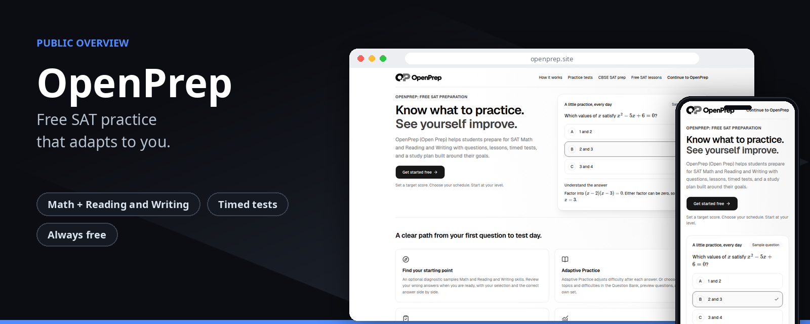
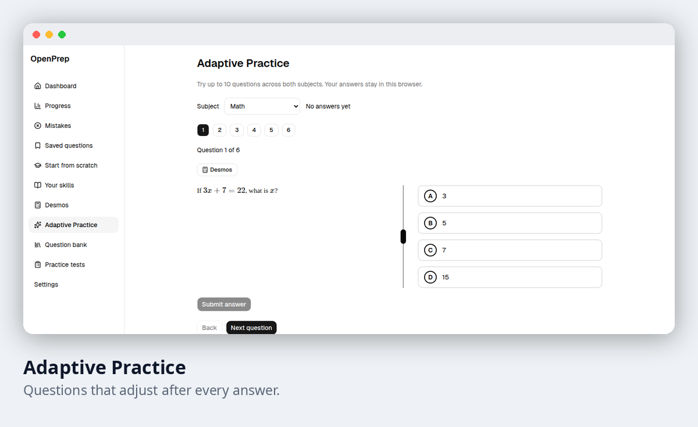
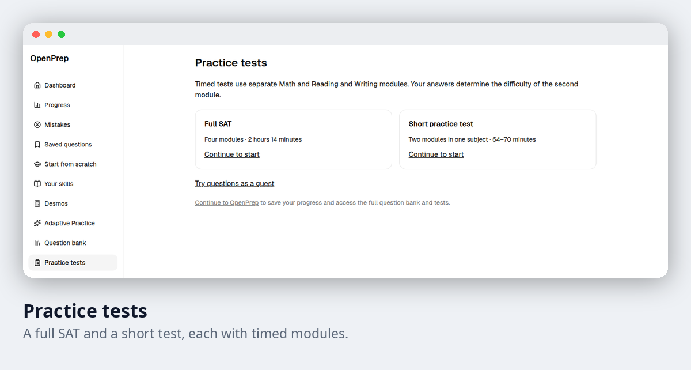
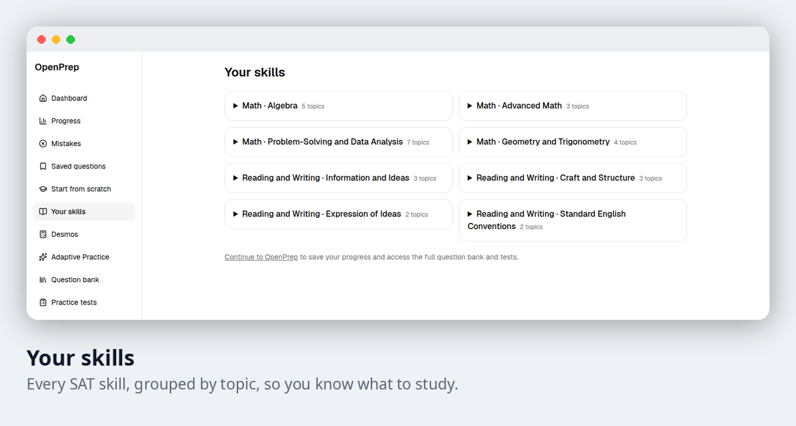
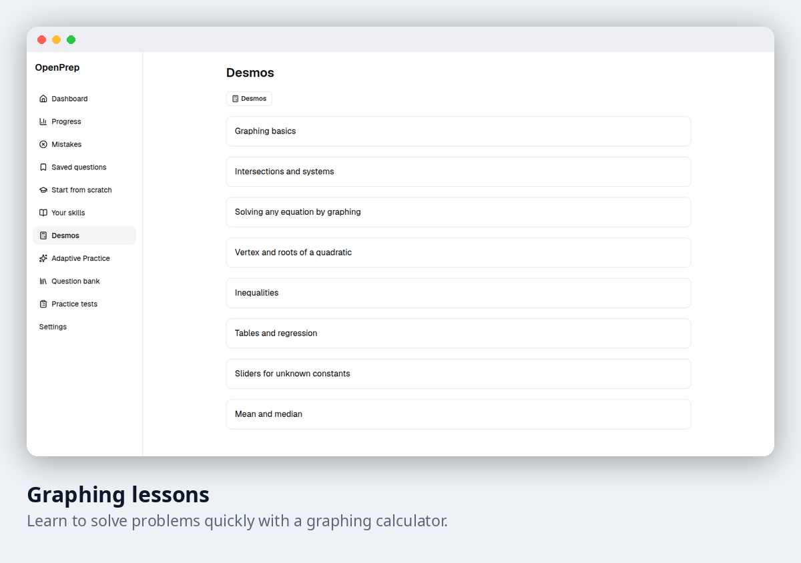
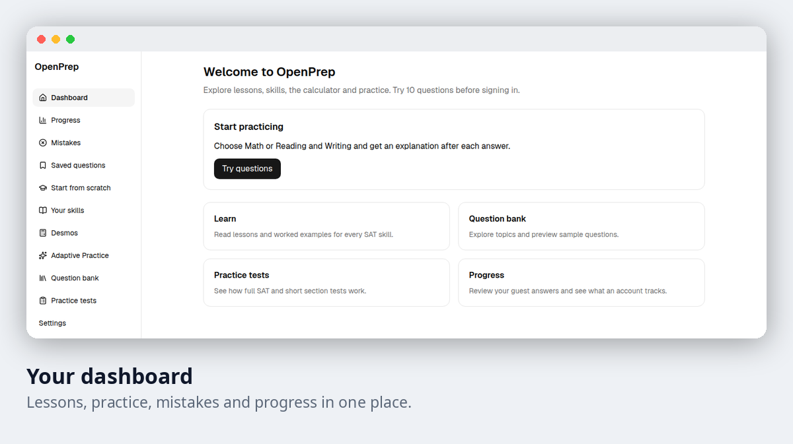

# OpenPrep

**Free SAT practice that adapts to you.**

OpenPrep gives students a question bank, short lessons and timed tests, then changes what to practise next based on how they are really doing.

**Try it free:** https://openprep.site

| | |
|---|---|
| **Practice questions** | 261 (171 Math, 90 Reading and Writing) |
| **Lessons** | 29 (19 Math, 10 Reading and Writing) |
| **Graphing lessons** | 8, on using a graphing calculator to solve problems faster |
| **Practice tests** | A full SAT and a short test, both timed |
| **Cost** | Free |

## How it works

1. **Start.** Answer a short setup and pick your goals. An optional starting test gives you a first profile.
2. **Practise.** Questions adjust after every answer, so you spend your time on what you need most.
3. **Review.** See what to fix, read why an answer works, and watch your progress build.

## A look inside

<table>
<tr>
<td width="50%"></td>
<td width="50%"></td>
</tr>
<tr>
<td width="50%"></td>
<td width="50%"></td>
</tr>
</table>

## What is inside

| Feature | What it gives you |
|---|---|
| Question bank | Practice questions for both SAT Math and Reading and Writing. |
| Lessons | Short lessons on every tested skill, with worked examples. |
| Adaptive Practice | Questions that get easier or harder to match you. |
| Practice tests | Timed modules, where your answers set how hard the second module is. |
| Written explanations | Why the right answer works, why a wrong answer fails, and another way to solve it. |
| Your skills | Every skill grouped by topic, so you know what to study next. |
| Progress and mistakes | Charts of how you are improving, and a list of what you got wrong. |
| Saved questions | Bookmark a question and come back to it. |
| Reminders | Optional study reminders. |
| Light and dark themes | Easy to read at any hour. |
| Android app | OpenPrep on your phone. |

## Who it is for

Students preparing for the SAT who want clear practice without paying, and teachers who want one simple link to give them.

## Your privacy

You sign in with an email or a Google account. At the time of writing OpenPrep uses no advertising trackers and does not sell personal data. The full policy is on the site.

## Status

| | |
|---|---|
| Web app | Live at https://openprep.site |
| Source code | Private |
| This repository | Overview only, with no code |

## Credits

Made by [@Shashanksaraswat123939](https://github.com/Shashanksaraswat123939), with help from [@mxnviir](https://github.com/mxnviir).

## Rights

This page is a public overview of a private project. It contains no source code and does not describe how the project is built.

All rights reserved. You are welcome to read this page and share the link. You may not copy, reproduce or recreate the project from this material, and you may not use it to train, prompt or instruct automated systems to produce a copy. See the [LICENSE](LICENSE) file.
